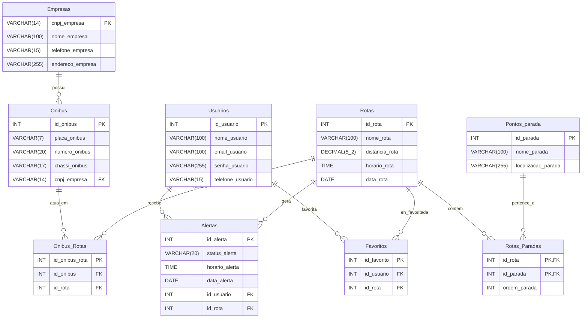

# Vale Rota

Sistema Inteligente de Transporte Público Intermunicipal
<br>
<hr>
<br>

## Descrição
Aplicativo web responsivo que centraliza horários e rotas intermunicipais, com previsão de atraso baseada em dados históricos de viagens e alertas personalizados para estudantes e trabalhadores.
<br>
<hr>
<br>

## Banco de Dados
### Diagrama ER do nosso sistema


<br>
<hr>
<br>

## Figma
https://www.figma.com/design/8dnbi4e3bP7HmgR3Ew6EHA/Design-PI?node-id=0-1&p=f&t=x6sdGn7aUDPXajC9-0
<br>
<hr>
<br>
## Diagrama de casos de uso

```mermaid
flowchart TB
    subgraph sistema["Sistema de Gestão de Rotas"]
        direction LR

        subgraph grupoUsuario["Usuário"]
            direction TB
            usuario@{ shape: person, label: "Usuário" }
            criarConta(["Criar conta"])
            visualizarRotas(["Visualizar rotas"])
            favoritarRota(["Favoritar rota"])
            acompanharOnibus(["Acompanhar ônibus"])
            tempoAtraso(["Visualizar tempo esperado de atraso"])
            receberNotificacoes(["Receber notificações"])
            usuario --- criarConta
            usuario --- visualizarRotas
            usuario --- favoritarRota
            usuario --- acompanharOnibus
            usuario --- tempoAtraso
            usuario --- receberNotificacoes
        end

        subgraph grupoMotorista["Motorista"]
            direction TB
            motorista@{ shape: person, label: "Motorista" }
            dirigirOnibus(["Dirigir ônibus"])
            reportarAtraso(["Reportar atraso"])
            iniciarEncerrar(["Iniciar e encerrar rota"])
            motorista --- dirigirOnibus
            motorista --- reportarAtraso
            motorista --- iniciarEncerrar
        end

        subgraph grupoEmpresa["Empresa de ônibus"]
            direction TB
            empresa@{ shape: person, label: "Empresa de ônibus" }
            fornecerHorarios(["Fornecer horários"])
            fornecerOnibus(["Fornecer ônibus"])
            acompanharTempoReal(["Acompanhar em tempo real"])
            alterarRotas(["Alterar rotas"])
            empresa --- fornecerHorarios
            empresa --- fornecerOnibus
            empresa --- acompanharTempoReal
            empresa --- alterarRotas
        end

        subgraph grupoAdmin["Administrador"]
            direction TB
            administrador@{ shape: person, label: "Administrador" }
            gerenciarRotas(["Gerenciar rotas"])
            atualizarSistema(["Atualizar sistema"])
            monitorar(["Monitorar"])
            suporte(["Suporte"])
            administrador --- gerenciarRotas
            administrador --- atualizarSistema
            administrador --- monitorar
            administrador --- suporte
        end

        subgraph grupoServicos["Serviços do sistema"]
            direction TB
            rastreamento(["Rastreamento"])
            enviarNotificacoes(["Enviar notificações"])
            gerarRelatorios(["Gerar relatórios"])
        end
    end

    atualizarSistema -. "estende" .-> fornecerHorarios
    acompanharTempoReal -. "estende" .-> monitorar
    monitorar -. "inclui" .-> rastreamento
    enviarNotificacoes -. "estende" .-> receberNotificacoes
    rastreamento -. "inclui" .-> receberNotificacoes

    classDef ator fill:#f0f9ff,stroke:#38bdf8,color:#0c4a6e
    classDef caso fill:#f5f3ff,stroke:#a78bfa,color:#3b0764
    classDef servico fill:#f0fdfa,stroke:#2dd4bf,color:#134e4a

    class usuario,motorista,empresa,administrador ator
    class criarConta,visualizarRotas,favoritarRota,acompanharOnibus,tempoAtraso,receberNotificacoes,dirigirOnibus,reportarAtraso,iniciarEncerrar,fornecerHorarios,fornecerOnibus,acompanharTempoReal,alterarRotas,gerenciarRotas,atualizarSistema,monitorar,suporte caso
    class rastreamento,enviarNotificacoes,gerarRelatorios servico
```

Site de consulta de horários e previsão de atrasos do transporte intermunicipal (Vale do Ribeira).
Feito com **Node.js + Express + EJS + Sequelize + MySQL**, seguindo o mesmo padrão do projeto da aula 09.

## Como instalar

1. Instale o **Node.js** (versão 18 ou superior): https://nodejs.org
2. Ligue o **MySQL** (XAMPP, WAMP, MySQL Workbench...). O padrão do projeto é usuário `root` sem senha.
   Se o seu tiver senha, altere em `config/sequelize-config.js`.
3. Extraia o .rar, abra a pasta no VS Code e, no terminal, rode:

```bash
npm install
npm start
```

4. Abra no navegador: http://localhost:8080

Na primeira execução o projeto **cria sozinho** o banco `vale_rota`, as tabelas e os dados de exemplo
(cidades, rotas, horários e paradas). Não é preciso criar nada manualmente.

## Estrutura

```
index.js                  -> servidor, sessão, conexão e sincronização do banco
config/
  sequelize-config.js     -> dados de conexão com o MySQL
  associations.js         -> relacionamentos entre as tabelas
  seed.js                 -> dados iniciais de exemplo
  helpers.js              -> funções usadas nas views
middleware/auth.js        -> controle de login (conta / visitante)
models/                   -> Usuario, Cidade, Rota, Viagem, Parada, Favorito, Alerta, Relato, Busca
controller/               -> Index (login), Busca, Favorito, Alerta, Perfil
views/                    -> telas .ejs (+ partials: header, navbar, footer)
public/                   -> css/style.css e js/js.js
```

## Relacionamentos

- Cidade 1:N Rota (origem e destino) · Rota 1:N Viagem · Viagem 1:N Parada
- Usuario 1:N Favorito · Alerta · Relato · Busca
- Rota 1:N Favorito/Busca · Viagem 1:N Alerta
- Usuario N:N Cidade (cidades de interesse, tabela `usuario_cidades`)

## Telas e rotas

| Tela | Rota |
|---|---|
| Login / criar conta / visitante | `/`, `/login`, `/cadastrar`, `/visitante`, `/sair` |
| Buscar | `/buscar` |
| Horários | `/horarios?origem=&destino=` |
| Detalhe da viagem | `/rota/:id` |
| Favoritos | `/favoritos` |
| Alertas | `/alertas` |
| Perfil | `/perfil` (dados, notificações, cidades, reportar problema, sobre) |

Observação: visitantes podem buscar horários, mas favoritos, alertas e perfil exigem conta.
